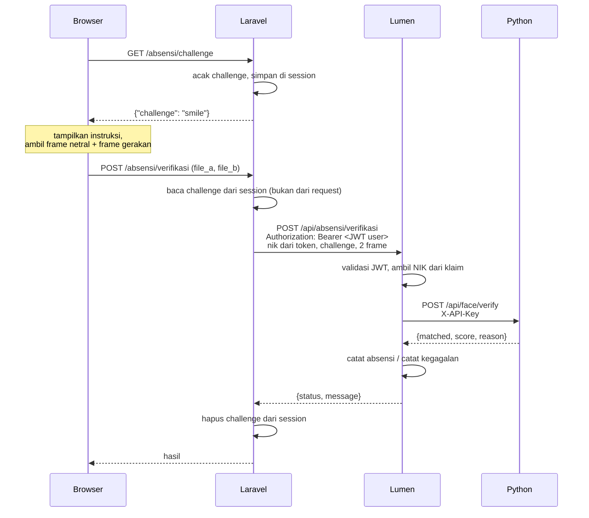

# Integrasi Sisi Laravel

Dokumen ini menjelaskan peran Laravel dalam alur verifikasi wajah dan bagaimana
ia berkomunikasi dengan Lumen.

Pasangan dokumen ini: [`integrasi-lumen.md`](integrasi-lumen.md).

---

## Peran Laravel

Laravel adalah **frontend + proxy**. Dalam alur ini ia mengerjakan tiga hal:

1. Menyajikan halaman absensi dan menerima dua frame wajah dari browser.
2. **Mengacak challenge liveness** dan menyimpannya di session.
3. Meneruskan frame + challenge + JWT user ke Lumen.

Yang **tidak** dikerjakan Laravel:

- Tidak tahu service Python ada. Tidak pernah memanggilnya, tidak memegang
  kredensialnya.
- Tidak mencatat absensi. Itu urusan Lumen.
- Tidak memutuskan wajah cocok atau tidak.

> Aturan praktis: kalau Laravel butuh tahu sesuatu tentang FaceNet, threshold,
> atau embedding — ada yang salah tempat.

---

## Alur Lengkap



Perhatikan: **challenge diminta lebih dulu dalam request terpisah**. Ini bukan
formalitas — browser harus tahu gerakan apa yang diminta sebelum merekam, dan
challenge harus sudah tercatat di server sebelum frame dikirim. Kalau challenge
ikut dikirim bersama frame, penyerang tinggal menyebut gerakan yang paling mudah
ia palsukan.

---

## 1. Membangkitkan Challenge

```php
// routes/web.php
Route::middleware('auth')->group(function () {
    Route::get('/absensi/challenge', [AbsensiController::class, 'challenge']);
    Route::post('/absensi/verifikasi', [AbsensiController::class, 'verifikasi']);
});
```

```php
private const CHALLENGES = ['smile', 'look_left', 'look_right'];
private const CHALLENGE_TTL = 120; // detik

public function challenge(Request $request)
{
    // Diacak di server. Nilai dari klien tidak pernah dipercaya.
    $challenge = self::CHALLENGES[random_int(0, count(self::CHALLENGES) - 1)];

    $request->session()->put('face_challenge', [
        'value'      => $challenge,
        'expires_at' => now()->addSeconds(self::CHALLENGE_TTL)->timestamp,
    ]);

    return response()->json(['challenge' => $challenge]);
}
```

`random_int()` — bukan `rand()` atau `array_rand()`. Ini keputusan keamanan:
challenge yang bisa diprediksi memungkinkan penyerang menyiapkan video palsu
sebelum diminta.

### Aturan penanganan challenge

| Aturan | Alasan |
|---|---|
| Diacak di server, disimpan di session | Klien tidak boleh memilih gerakannya sendiri |
| Ada TTL pendek (~2 menit) | Membatasi jendela penyiapan rekaman palsu |
| **Sekali pakai** — hapus setelah dipakai | Mencegah replay dengan pasangan frame yang sama |
| Nilai di request body diabaikan | Satu-satunya sumber kebenaran adalah session |

> **Catatan desain.** Anda memilih Laravel sebagai pengacak challenge, jadi
> Lumen mempercayai nilai yang datang dari Laravel. Itu aman **selama** nilainya
> benar-benar lahir di server Laravel dan tidak pernah disalin dari input
> browser. Baris `$request->input('challenge')` di alur ini adalah bug keamanan,
> bukan sekadar gaya penulisan.

---

## 2. Meneruskan ke Lumen

```php
public function verifikasi(Request $request)
{
    $request->validate([
        'file_a' => 'required|image|max:5120',   // frame netral
        'file_b' => 'required|image|max:5120',   // frame setelah gerakan
    ]);

    // Challenge diambil dari session, BUKAN dari $request
    $sesi = $request->session()->get('face_challenge');
    if (!$sesi || $sesi['expires_at'] < now()->timestamp) {
        return response()->json([
            'status'  => 'error',
            'message' => 'Sesi verifikasi kedaluwarsa. Ulangi dari awal.',
        ], 422);
    }

    // Sekali pakai — dihapus sebelum dipakai agar gagal pun tidak bisa di-replay
    $request->session()->forget('face_challenge');

    $response = Http::withToken($request->bearerToken() ?? session('jwt'))
        ->timeout(20)
        ->connectTimeout(5)
        ->withHeaders(['X-Request-Id' => (string) Str::uuid()])
        ->attach('file_a', file_get_contents($request->file('file_a')), 'a.jpg')
        ->attach('file_b', file_get_contents($request->file('file_b')), 'b.jpg')
        ->post(config('services.lumen.url') . '/api/absensi/verifikasi', [
            'challenge' => $sesi['value'],
        ]);

    if ($response->failed()) {
        report(new \RuntimeException('Lumen gagal: ' . $response->status()));
        return response()->json([
            'status'  => 'error',
            'message' => 'Layanan absensi sedang bermasalah. Coba lagi.',
        ], 503);
    }

    return response()->json($response->json());
}
```

### Yang perlu diperhatikan

**JWT diteruskan apa adanya.** Laravel tidak membuat token baru dan tidak
menerjemahkan identitas user. Lumen-lah yang memvalidasi JWT dan mengambil NIK
dari klaimnya — lihat dokumen Lumen. Konsekuensinya: **Laravel tidak perlu dan
tidak boleh mengirim NIK.** Kalau NIK ikut dikirim sebagai field request, Lumen
harus mengabaikannya.

**Multipart, bukan base64.** `attach()` mengirim biner apa adanya. Meng-encode
base64 membengkakkan payload ~33% di setiap hop — dan di sini ada dua hop.

**Timeout dua lapis.** `connectTimeout(5)` untuk gagal cepat kalau Lumen mati;
`timeout(20)` untuk menunggu pemrosesan. Angka 20 detik dipilih karena Lumen
sendiri menunggu Python (inference CPU ~0.3–1 detik untuk dua deteksi landmark
plus satu embedding), ditambah margin. Default Laravel yang lebih pendek akan
memutus request yang sebenarnya masih berjalan normal — dan gejalanya menyesatkan:
absensi tampak gagal padahal Lumen sudah mencatatnya.

**`X-Request-Id`.** Satu UUID yang diteruskan Laravel → Lumen → Python membuat
satu percobaan absensi bisa dilacak di tiga log yang berbeda. Tanpa ini,
menelusuri satu keluhan "absen saya gagal" berarti mencocokkan timestamp manual.

---

## 3. Konfigurasi

```php
// config/services.php
'lumen' => [
    'url' => env('LUMEN_API_URL'),
],
```

```ini
# .env
LUMEN_API_URL=http://127.0.0.1:8001
```

Laravel **tidak** punya `FACE_SERVICE_URL` maupun `FACE_API_KEY`. Kalau kedua
variabel itu muncul di `.env` Laravel, berarti ada kode yang memotong jalur
langsung ke Python — itu melanggar desain dan menghilangkan jaminan bahwa
identitas hasil verifikasi tidak bisa dipalsukan.

---

## 4. Menangani Respons

Lumen mengembalikan hasil bisnis dengan status `200`, termasuk untuk kegagalan
verifikasi. Bedakan dari kegagalan teknis:

| Kondisi | Status | Sikap Laravel |
|---|---|---|
| Absensi tercatat | 200 | Tampilkan sukses |
| Wajah tidak cocok / liveness gagal | 200 | Tampilkan pesan dari Lumen, minta ulang |
| JWT tidak valid / kedaluwarsa | 401 | Arahkan ke login |
| Validasi gagal | 422 | Tampilkan pesan validasi |
| Lumen/Python mati | 503 | Pesan generik, jangan bocorkan detail internal |

Jangan menerjemahkan ulang pesan kegagalan verifikasi di Laravel. Pesan itu
lahir di Lumen bersama konteksnya (`reason`); menyalinnya berarti dua tempat yang
harus diubah setiap kali kata-katanya disesuaikan.

---

## Checklist

- [ ] Challenge diacak dengan `random_int()` di server
- [ ] Challenge disimpan di session, ada TTL, dan **dihapus setelah dipakai**
- [ ] Nilai `challenge` dari request body tidak pernah dibaca
- [ ] NIK tidak dikirim dari Laravel — Lumen mengambilnya dari JWT
- [ ] File dikirim sebagai multipart, bukan base64
- [ ] `connectTimeout` dan `timeout` diset eksplisit
- [ ] `X-Request-Id` diteruskan
- [ ] Tidak ada referensi ke service Python di seluruh kode Laravel
- [ ] `upload_max_filesize` dan `post_max_size` cukup untuk dua frame sekaligus
