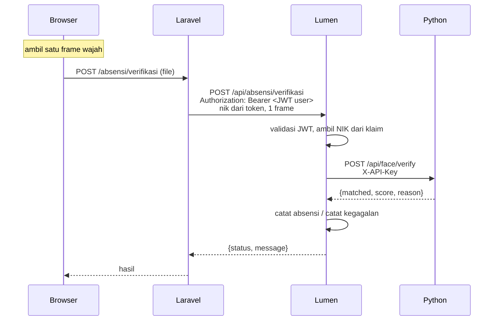

# Integrasi Sisi Laravel

Dokumen ini menjelaskan peran Laravel dalam alur verifikasi wajah dan bagaimana
ia berkomunikasi dengan Lumen.

Pasangan dokumen ini: [`integrasi-lumen.md`](integrasi-lumen.md).

---

## Peran Laravel

Laravel adalah **frontend + proxy**. Dalam alur ini ia mengerjakan dua hal:

1. Menyajikan halaman absensi dan menerima satu frame wajah dari browser.
2. Meneruskan frame + JWT user ke Lumen.

Yang **tidak** dikerjakan Laravel:

- Tidak tahu service Python ada. Tidak pernah memanggilnya, tidak memegang
  kredensialnya.
- Tidak mencatat absensi. Itu urusan Lumen.
- Tidak memutuskan wajah cocok atau tidak.

> Aturan praktis: kalau Laravel butuh tahu sesuatu tentang FaceNet, threshold,
> atau embedding — ada yang salah tempat.

---

## Alur Lengkap



Tidak ada request challenge terpisah: service Python hanya mendeteksi dan
mencocokkan satu frame. Konsekuensinya tidak ada lapisan anti-spoofing — foto
atau layar HP yang diarahkan ke kamera akan diperlakukan seperti wajah asli.
Kalau risiko itu perlu ditutup, tambahkan liveness sebagai layanan terpisah;
jangan mengandalkan pencocokan wajah saja.

---

## 1. Meneruskan ke Lumen

```php
// routes/web.php
Route::middleware('auth')->group(function () {
    Route::post('/absensi/verifikasi', [AbsensiController::class, 'verifikasi']);
});
```

```php
public function verifikasi(Request $request)
{
    $request->validate([
        'file' => 'required|image|max:5120',
    ]);

    $response = Http::withToken($request->bearerToken() ?? session('jwt'))
        ->timeout(20)
        ->connectTimeout(5)
        ->withHeaders(['X-Request-Id' => (string) Str::uuid()])
        ->attach('file', file_get_contents($request->file('file')), 'face.jpg')
        ->post(config('services.lumen.url') . '/api/absensi/verifikasi');

    if ($response->failed()) {
        report(new \RuntimeException('Lumen gagal: ' . $response->status()));
        return response()->json([
            'status'  => 'error',
            'message' => 'Layanan absensi sedang bermasalah. Coba lagi.',
        ], 503);
    }

    return response()->json($response->json());
}
```

### Yang perlu diperhatikan

**JWT diteruskan apa adanya.** Laravel tidak membuat token baru dan tidak
menerjemahkan identitas user. Lumen-lah yang memvalidasi JWT dan mengambil NIK
dari klaimnya — lihat dokumen Lumen. Konsekuensinya: **Laravel tidak perlu dan
tidak boleh mengirim NIK.** Kalau NIK ikut dikirim sebagai field request, Lumen
harus mengabaikannya.

**Multipart, bukan base64.** `attach()` mengirim biner apa adanya. Meng-encode
base64 membengkakkan payload ~33% di setiap hop — dan di sini ada dua hop.

**Timeout dua lapis.** `connectTimeout(5)` untuk gagal cepat kalau Lumen mati;
`timeout(20)` untuk menunggu pemrosesan. Angka 20 detik dipilih karena Lumen
sendiri menunggu Python (inference CPU ~0.3–1 detik untuk satu deteksi plus
satu embedding), ditambah margin. Default Laravel yang lebih pendek akan
memutus request yang sebenarnya masih berjalan normal — dan gejalanya menyesatkan:
absensi tampak gagal padahal Lumen sudah mencatatnya.

**`X-Request-Id`.** Satu UUID yang diteruskan Laravel → Lumen → Python membuat
satu percobaan absensi bisa dilacak di tiga log yang berbeda. Tanpa ini,
menelusuri satu keluhan "absen saya gagal" berarti mencocokkan timestamp manual.

---

## 2. Konfigurasi

```php
// config/services.php
'lumen' => [
    'url' => env('LUMEN_API_URL'),
],
```

```ini
# .env
LUMEN_API_URL=http://127.0.0.1:8001
```

Laravel **tidak** punya `FACE_SERVICE_URL` maupun `FACE_API_KEY`. Kalau kedua
variabel itu muncul di `.env` Laravel, berarti ada kode yang memotong jalur
langsung ke Python — itu melanggar desain dan menghilangkan jaminan bahwa
identitas hasil verifikasi tidak bisa dipalsukan.

---

## 3. Menangani Respons

Lumen mengembalikan hasil bisnis dengan status `200`, termasuk untuk kegagalan
verifikasi. Bedakan dari kegagalan teknis:

| Kondisi | Status | Sikap Laravel |
|---|---|---|
| Absensi tercatat | 200 | Tampilkan sukses |
| Wajah tidak cocok / belum terdaftar | 200 | Tampilkan pesan dari Lumen, minta ulang |
| JWT tidak valid / kedaluwarsa | 401 | Arahkan ke login |
| Validasi gagal | 422 | Tampilkan pesan validasi |
| Lumen/Python mati | 503 | Pesan generik, jangan bocorkan detail internal |

Jangan menerjemahkan ulang pesan kegagalan verifikasi di Laravel. Pesan itu
lahir di Lumen bersama konteksnya (`reason`); menyalinnya berarti dua tempat yang
harus diubah setiap kali kata-katanya disesuaikan.

---

## 4. Varian Kiosk (tanpa login)

Alur di atas mengasumsikan karyawan sudah login, sehingga identitasnya dibawa
JWT. Untuk **tablet absensi bersama di lobi** tidak ada login: karyawan datang,
menghadap kamera, selesai. Lumen memakai endpoint `/identify` untuk kasus ini —
lihat [`integrasi-lumen.md`](integrasi-lumen.md#6-identifikasi-1n-identify--mode-kiosk).

Yang berubah di sisi Laravel hanya dua hal:

```php
// 1. Rute kiosk terpisah, TIDAK di dalam middleware 'auth'
Route::middleware('kiosk')->group(function () {
    Route::post('/kiosk/absensi',   [KioskController::class, 'absensi']);
});

// 2. Yang diteruskan adalah token perangkat, bukan JWT user
$response = Http::withToken(config('services.kiosk.token'))
    ->timeout(20)
    ->connectTimeout(5)
    // ... attach file — sama persis dengan alur biasa
    ->post(config('services.lumen.url') . '/api/absensi/kiosk');
```

Sisanya identik dengan alur biasa: satu frame, tanpa challenge. Karena tidak ada
liveness, kiosk di area publik lebih rawan dibanding alur ber-JWT — siapa pun
bisa mengangkat foto karyawan ke kamera. Perlakukan keputusan memakai kiosk
sebagai keputusan risiko, bukan sekadar pilihan UI.

### Dua aturan yang mudah dilanggar

**Jangan pakai jalur kiosk untuk user yang sudah login.** Kalau session user
ada, pakai alur biasa. Mengidentifikasi ulang wajah orang yang identitasnya
sudah dijamin token adalah pemeriksaan yang lebih lemah, bukan lebih ketat.

**Jangan pernah menampilkan daftar kandidat.** Lumen hanya mengembalikan nama
ketika wajah benar-benar cocok. Kalau gagal, tampilkan pesan generik dan arahkan
ke absensi manual — jangan menampilkan "mungkin maksud Anda ...".

Token kiosk disimpan di `.env` Laravel dan terikat pada satu lokasi. Perangkat
yang hilang berarti token itu harus dicabut di Lumen — pastikan prosedurnya ada
sebelum kiosk pertama dipasang.

---

## Checklist

- [ ] NIK tidak dikirim dari Laravel — Lumen mengambilnya dari JWT
- [ ] File dikirim sebagai multipart, bukan base64
- [ ] `connectTimeout` dan `timeout` diset eksplisit
- [ ] `X-Request-Id` diteruskan
- [ ] Tidak ada referensi ke service Python di seluruh kode Laravel
- [ ] `upload_max_filesize` dan `post_max_size` cukup untuk satu frame

Tambahan bila varian kiosk dipakai:

- [ ] Rute kiosk terpisah dari rute ber-`auth`, tidak saling memakai controller
- [ ] Token kiosk terikat satu lokasi dan punya prosedur pencabutan
- [ ] Kegagalan identifikasi menampilkan pesan generik, bukan daftar kandidat
